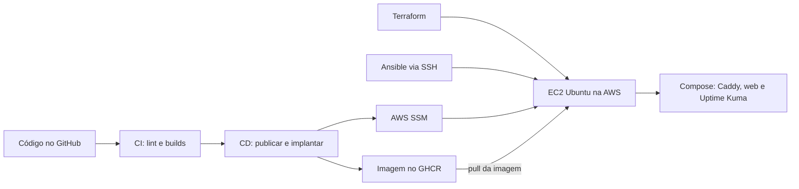

# Cloud DevOps

Infraestrutura AWS em código, configuração de servidores Ubuntu e entrega de uma aplicação web em contêineres.

[](https://github.com/erikgdl/cloud-devops-aws/actions/workflows/ci.yml)
[](https://github.com/erikgdl/cloud-devops-aws/actions/workflows/cd.yml)

O projeto aborda a reprodução de ambientes configurados manualmente.
Terraform descreve os recursos na AWS, Ansible prepara o servidor e Docker distribui a aplicação.
O GitHub Actions valida o código, publica a imagem no GitHub Container Registry (GHCR) e atualiza a EC2 por AWS Systems Manager (SSM).

A aplicação React/Vite apresenta o trabalho acadêmico **Anatomia de um deploy**, de DevOps e Computação em Nuvem.
Ela também é o artefato estático entregue pela infraestrutura.

**[Explorar a documentação](docs/README.md)** · **[Reproduzir a implantação](docs/implantacao.md)** · **[Consultar os workflows](.github/workflows/)**

## Sumário

- [Visão geral](#visão-geral)
- [Tecnologias e responsabilidades](#tecnologias-e-responsabilidades)
- [Arquitetura](#arquitetura)
- [Início rápido](#início-rápido)
- [Implantação e portabilidade](#implantação-e-portabilidade)
- [Operação e segurança](#operação-e-segurança)
- [Estrutura do repositório](#estrutura-do-repositório)
- [Documentação técnica](#documentação-técnica)
- [Contexto acadêmico e créditos](#contexto-acadêmico-e-créditos)
- [Contribuição e licença](#contribuição-e-licença)

## Visão geral

O repositório implementa três responsabilidades complementares:

1. **Provisionar:** Terraform cria EC2 Ubuntu, Elastic IP, regras de acesso e permissões IAM, utilizando a VPC padrão existente.
2. **Configurar:** Ansible instala Docker/Compose e gera a configuração de aplicação, proxy HTTPS e monitoramento.
3. **Entregar:** GitHub Actions publica imagens com tags `latest` e SHA do commit; o CD implanta a tag SHA.

No servidor, Caddy encaminha requisições para Nginx e Uptime Kuma.
O frontend não possui API própria ou banco de dados.
A persistência do monitoramento e do Caddy utiliza volumes Docker.

## Tecnologias e responsabilidades

| Tecnologia | Uso neste projeto |
| --- | --- |
| React e Vite | Componentes da página e compilação de arquivos estáticos |
| Nginx | Servidor da aplicação na porta interna `8080` |
| Docker e Compose | Imagem em múltiplos estágios e execução dos serviços |
| Terraform e AWS | EC2, Elastic IP, Security Group, IAM e integração SSM |
| Ansible | Instalação de pacotes e configuração declarativa do host Ubuntu |
| GitHub Actions e GHCR | Validação, publicação da imagem e atualização remota |
| Caddy | Proxy reverso e HTTPS automático para os domínios configurados |
| Uptime Kuma | Serviço para cadastrar monitores de disponibilidade |

As escolhas e os limites de cada camada estão em [Arquitetura](docs/arquitetura.md).

## Arquitetura



Terraform e Ansible são executados manualmente; os workflows não os executam.
O CD pressupõe que o host já foi configurado e está disponível no SSM.
Veja a [arquitetura detalhada e a comunicação dos serviços](docs/arquitetura.md).

## Início rápido

Para desenvolver o frontend, utilize **Node.js 24 e npm**, seguindo a versão principal utilizada pelo Dockerfile.
Execute na raiz do clone:

```sh
npm ci
npm run dev
```

Abra o endereço exibido pelo Vite.
Os comandos `npm run lint`, `npm run build` e `npm run preview` verificam o código, geram `dist/` e permitem conferir o build.

Para executar a aplicação estática com **Docker para contêineres Linux e Compose v2**, use Bash, por exemplo no Linux ou WSL:

```bash
docker build -t cloud-devops:local .
HTTP_PORT=8080 docker compose config --quiet
HTTP_PORT=8080 docker compose up -d
curl -I http://localhost:8080/
```

O Compose da raiz executa somente a aplicação, sem Caddy ou Kuma.
Ele utiliza uma imagem pronta e não realiza o build.
Para encerrar: `docker compose down`.
Consulte [Desenvolvimento e Docker](docs/desenvolvimento.md) para variáveis, outros shells e verificações.

## Implantação e portabilidade

- **AWS:** o Terraform depende de credenciais, backend S3, VPC padrão, chave SSH e provedor OIDC previamente preparados.
- **Ubuntu fora da AWS:** o playbook pode configurar um host compatível por SSH, sem utilizar as APIs da AWS.
  É necessário atender aos requisitos de sistema, rede, imagens e domínios.
- **Docker local:** a aplicação pode ser construída e executada sem provisionar recursos AWS.
- **CD:** a implementação atual é específica para uma EC2 e para o ambiente AWS original.
  Ela não é automaticamente transferida para outro servidor ou fork.

O [guia de implantação](docs/implantacao.md) apresenta os procedimentos e as condições de reprodução.
Não há evidência versionada suficiente para afirmar que todos os ambientes citados na interface foram testados.

## Operação e segurança

No Compose gerado pelo Ansible, Caddy publica TCP `80/443`.
Aplicação e Kuma também possuem acessos de diagnóstico em `127.0.0.1:8080` e `127.0.0.1:3001` no host.
**O Caddy também expõe o Kuma pelo domínio configurado**, apesar de sua porta direta estar em loopback.

O Terraform exige IMDSv2, criptografa o volume raiz e restringe SSH por CIDR.
O CD utiliza credenciais temporárias via OIDC.
A administração do Kuma, a configuração dos monitores, os backups e a validação externa do HTTPS exigem atuação do operador.

Consulte [Operação e segurança](docs/operacao-e-seguranca.md) antes de publicar o ambiente ou manipular volumes e credenciais.

## Estrutura do repositório

```text
.
├── .github/workflows/    # CI e CD
├── ansible/              # Playbook e modelo de inventário
├── docs/                 # Referência técnica e procedimentos
├── public/               # Arquivos públicos e créditos dos ícones
├── src/                  # Aplicação React, estilos e recursos visuais
├── terraform/            # Recursos AWS, backend, variáveis e outputs
├── Dockerfile            # Build Vite e imagem de execução Nginx
├── docker-compose.yaml   # Execução local do serviço web
└── nginx.conf            # Servidor estático na porta 8080
```

## Documentação técnica

| Documento | Conteúdo |
| --- | --- |
| [Índice](docs/README.md) | Percursos de leitura e convenções |
| [Arquitetura](docs/arquitetura.md) | Componentes, fluxos e limites da solução |
| [Infraestrutura](docs/infraestrutura.md) | Terraform, recursos AWS e dependências externas |
| [Automação](docs/automacao.md) | Inventário, variáveis e tarefas Ansible |
| [Desenvolvimento](docs/desenvolvimento.md) | Frontend, Docker e validações locais |
| [Implantação](docs/implantacao.md) | Reprodução na AWS e em Ubuntu compatível |
| [CI/CD](docs/ci-cd.md) | Workflows, imagens, OIDC e SSM |
| [Operação e segurança](docs/operacao-e-seguranca.md) | HTTPS, monitoramento, diagnóstico e cuidados operacionais |
| [Direção visual](docs/design-direction.md) | Organização e decisões visuais da aplicação |

## Contexto acadêmico e créditos

A interface identifica o trabalho como uma defesa acadêmica N2 de DevOps e Computação em Nuvem.
Os botões de apresentação abrem os 18 slides da N2 em `/#/apresentacao/1`, com navegação por teclado, visão geral e opção de tela cheia.
O conteúdo segue [APRESENTACAO-N2.md](APRESENTACAO-N2.md); consulte o [guia da apresentação](docs/apresentacao.md) para uso e manutenção.

Os créditos dos ícones estão em [public/creditos-icones.txt](public/creditos-icones.txt).
As licenças de recursos visuais ficam em [src/assets/architecture/](src/assets/architecture/).

[COMMIT DE TEST 02]

## Contribuição e licença

Antes de propor alterações, consulte o [guia de desenvolvimento](docs/desenvolvimento.md) e execute as verificações pertinentes à área modificada.
Mudanças operacionais devem atualizar a documentação correspondente.

O repositório não contém uma licença geral na raiz.
As licenças dos recursos visuais têm seus próprios escopos e não definem a licença de todo o código.
