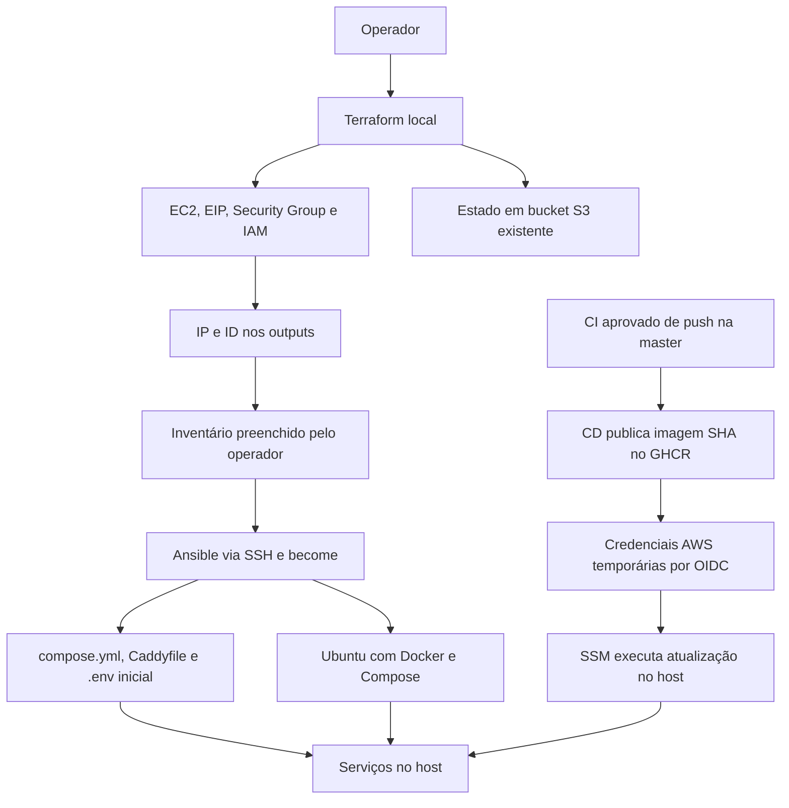
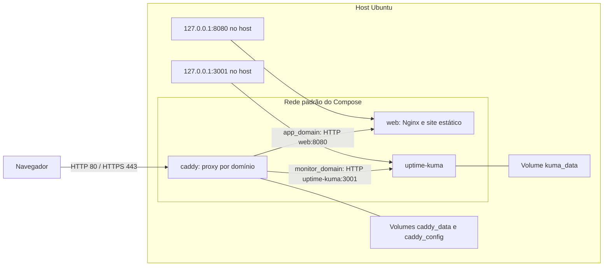

# Arquitetura da solução

O Cloud DevOps registra em código as etapas necessárias para publicar um site em um servidor Ubuntu.
A solução separa criação de recursos, configuração do sistema e distribuição da aplicação.
Essa separação permite identificar qual artefato controla cada parte do ambiente e quais etapas continuam externas ao repositório.

## Aplicação entregue

[src/main.jsx](../src/main.jsx) inicializa o React e carrega os estilos globais.
[src/App.jsx](../src/App.jsx) reúne cabeçalho, página e rodapé, além de controlar a navegação por fragmentos de URL.
[HomePage.jsx](../src/pages/home/HomePage.jsx) organiza os capítulos sobre problema, solução, arquitetura, tecnologias, portabilidade e defesa.

O Vite compila a aplicação em arquivos estáticos em `dist/`.
Não há chamadas a uma API própria nem um serviço de backend no Compose.
O Nginx entrega HTML, CSS, JavaScript e recursos públicos na porta `8080`.
Como a navegação utiliza âncoras, [nginx.conf](../nginx.conf) devolve `404` para arquivos inexistentes, sem fallback geral para `index.html`.

## Responsabilidades e artefatos

| Camada | Artefato responsável | Resultado |
| --- | --- | --- |
| Infraestrutura | [terraform/](../terraform/) | EC2, Elastic IP, Security Group e permissões IAM |
| Configuração do host | [ansible/playbook.yml](../ansible/playbook.yml) | Docker, Compose, arquivos de configuração e serviços iniciados |
| Construção da aplicação | [Dockerfile](../Dockerfile) | Imagem Nginx com o build estático |
| Execução local | [docker-compose.yaml](../docker-compose.yaml) | Serviço `web` |
| Execução no servidor | Compose embutido no playbook | Serviços `web`, `caddy` e `uptime-kuma` |
| Validação e entrega | [workflows](../.github/workflows/) | Verificações, publicação no GHCR e atualização da EC2 por SSM |

O Compose de produção é gerado em `/opt/cloud-devops-aws/compose.yml`.
Ele não é uma cópia do Compose local.
O Caddyfile também está embutido no playbook; não há um arquivo Caddyfile independente no repositório.

## Provisionamento, configuração e entrega

Não há integração automática entre os outputs Terraform e o inventário Ansible.
O operador transporta as informações necessárias.
Terraform e Ansible não são executados pelos workflows.
O CD atualiza um host previamente configurado e não cria o ambiente do zero.

## Comunicação no servidor

O diagrama representa o Compose gerado pelo Ansible.
Os nomes `web` e `uptime-kuma` são resolvidos entre contêineres pela rede padrão do Compose.

O acesso público usa os domínios presentes no Caddyfile e o Elastic IP na implantação AWS.
O HTTPS termina no Caddy; as conexões dele para os serviços são HTTP na rede Docker.
Não há balanceador externo ou configuração de TLS entre os contêineres.

O backend local permite que Ansible e CD consultem a aplicação sem depender de redirecionamentos do proxy.
Essa consulta não valida o certificado nem a disponibilidade pública do site.
O domínio de monitoramento encaminha para o painel Kuma; sua porta direta em loopback não o torna privado pelo proxy.

O endereço `http://web:8080/` pode ser cadastrado como monitor no Kuma, pois ambos estão na mesma rede.
O cadastro não é realizado pelo playbook e, por isso, não aparece como integração já ativa no diagrama.

## Decisões observáveis e consequências

### Imagem separada do host

O [Dockerfile](../Dockerfile) compila com Node 24 e utiliza Nginx como imagem de execução.
O servidor recebe a imagem pronta, sem precisar instalar Node ou compilar React.
As imagens-base e os serviços auxiliares utilizam tags mutáveis; o código não fixa todos os digests.

### Configuração separada da versão implantada

O Ansible cria `.env` com `force: false`.
Uma nova execução preserva a referência de imagem já existente.
O CD altera `APP_IMAGE` nesse arquivo para selecionar o SHA publicado.
Os domínios permanecem no Caddyfile, sem depender de variáveis adicionais no `.env`.

### Estado concentrado em um servidor

A configuração cria uma única EC2 e executa os três serviços no mesmo host.
Os volumes permanecem nesse ambiente Docker; não existe armazenamento compartilhado ou alta disponibilidade implementada.
Uma falha do host pode afetar aplicação, proxy e monitoramento simultaneamente.

### VPC existente e configuração específica da AWS

O Terraform consulta a VPC padrão e seleciona a primeira subnet após ordenar seus IDs.
Não cria uma topologia de rede própria.
A portabilidade do frontend e das tarefas Ansible não torna o Terraform nem o CD independentes de provedor.

## Limites da representação acadêmica

Alguns textos e desenhos de [src/pages/home/sections/](../src/pages/home/sections/) mencionam ECR Public e dois destinos Ubuntu.
Os workflows atuais utilizam GHCR, e o inventário de exemplo apresenta um único host.
O repositório não contém evidências de validação dos dois destinos.

O botão de apresentação está desabilitado em [PresentationButton.jsx](../src/components/PresentationButton.jsx).
Não há navegação para slides implementada.

## Documentos relacionados

- [Infraestrutura](infraestrutura.md): recursos e dependências do Terraform.
- [Automação](automacao.md): configuração e arquivos gerados pelo Ansible.
- [Implantação](implantacao.md): execução das etapas pelo operador.
- [CI/CD](ci-cd.md): publicação e atualização por SSM.
- [Operação e segurança](operacao-e-seguranca.md): validação externa e administração.
