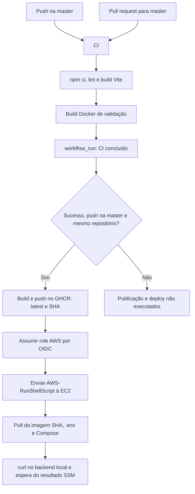

# CI/CD com GitHub Actions

Este documento referencia os workflows [CI](../.github/workflows/ci.yml) e [CD](../.github/workflows/cd.yml).
Eles validam a aplicação, publicam sua imagem no GHCR e atualizam uma EC2 existente por SSM.
A presença dos workflows não comprova o estado de uma execução; os resultados ficam no GitHub Actions.

## Fluxo e condições de execução



O CI responde a `push` em `master` e a `pull_request` cujo destino seja `master`.
O CD usa `workflow_run`, com tipo `completed`, para o workflow chamado exatamente `CI`.
O job `publish` exige conclusão bem-sucedida, evento original `push`, branch `master` e repositório de origem igual ao atual.
O job `deploy` depende do sucesso de `publish`.

Não há `workflow_dispatch`, filtros por caminho, matriz de ambientes ou aprovação por GitHub Environment definidos.
**Um push somente de documentação em `master` também pode acionar CI, publicação e deploy**, pois não existe exceção para Markdown.

## Validação contínua

O job `build`, do CI, executa em `ubuntu-latest` e tem `contents: read`.
Ele utiliza `actions/checkout@v6` e `actions/setup-node@v6`, com Node 22 e cache npm.

| Etapa | Comando e efeito |
| --- | --- |
| Dependências | `npm ci` com o lockfile |
| Lint | `npm run lint --if-present`; o script está presente no projeto atual |
| Build web | `npm run build` |
| Build Docker | `docker build -t cloud-devops-aws:ci .` |

A imagem construída no CI não é publicada nem transferida para o CD.
O CD realiza outro build do mesmo commit.
Não há testes automatizados, execução de contêiner para teste, validação Terraform/Ansible ou verificação de Markdown nesses workflows.

## Publicação no GHCR

O job `publish` baixa o commit exato indicado por `github.event.workflow_run.head_sha`.
O checkout usa `persist-credentials: false`.
Em seguida, configura Buildx, autentica no GHCR e executa `docker/build-push-action@v6`.

A autenticação usa o `GITHUB_TOKEN` da execução, com `contents: read` e `packages: write`.
Não há necessidade de um token pessoal estático configurado no YAML para essa etapa.

As referências publicadas são:

```text
ghcr.io/erikgdl/cloud-devops-aws:latest
ghcr.io/erikgdl/cloud-devops-aws:<SHA completo do commit>
```

A label OCI de origem aponta para o repositório GitHub.
Não há publicação em ECR no workflow atual, apesar de referências antigas na interface.
Também não há configuração explícita de `platforms` para uma imagem multiarch.

A tag SHA associa a entrega ao commit, mas o workflow não faz deploy por digest nem impõe imutabilidade das tags no registro.
A visibilidade pública do pacote é uma configuração externa ao YAML.
Ansible e SSM não fazem `docker login`; precisam conseguir baixar a imagem com as condições de acesso existentes no host.

## Autenticação AWS por OIDC

O job `deploy` possui `id-token: write` e usa `aws-actions/configure-aws-credentials@v4`.
Ele solicita credenciais temporárias para uma role fixa, na região `us-east-1`.
O código não utiliza um par estático de access key/secret key AWS nesse job.

[terraform/oidc.tf](../terraform/oidc.tf) define a trust policy dessa role.
Ela exige a audiência `sts.amazonaws.com` e um subject específico da identidade do repositório original na branch `master`.
O provedor IAM OIDC referenciado precisa existir previamente na conta AWS.
Compatibilidade entre o token emitido e essa policy deve ser conferida no ambiente real, especialmente em um fork.

A policy permite enviar `AWS-RunShellScript` à EC2 criada pelo Terraform e consultar o resultado na região permitida.
Ela não é uma policy de provisionamento completo.

## Atualização remota por SSM

O script de CD valida que o SHA contém 40 caracteres hexadecimais minúsculos.
Depois constrói um payload JSON com `jq` e envia um comando SSM à instância configurada.

No host, a sequência é:

1. Ativar `set -eu` e acessar `/opt/cloud-devops-aws`.
2. Executar `docker pull` da imagem com a tag SHA.
3. Regravar `.env` contendo somente `APP_IMAGE` com essa referência.
4. Executar `docker compose up -d --pull never`.
5. Consultar `http://127.0.0.1:8080/` com `curl -fsS` e tentativas de reconexão.

O runner aguarda `aws ssm wait command-executed`.
Em caso de falha nessa espera, consulta `get-command-invocation` para apresentar o resultado e termina com erro.

`curl -f` sinaliza erros HTTP a partir de `400`; esse comando não exige explicitamente `200` nem verifica conteúdo.
Já a verificação do Ansible exige status `200`.
Nenhuma das duas etapas valida o certificado público, o DNS ou a saúde do Kuma.

O `--pull never` pressupõe que Caddy e Kuma já estão disponíveis no host após o bootstrap Ansible.
O CD não instala Docker, Compose, SSM Agent ou `curl` e não copia Compose/Caddyfile para o servidor.

## Vínculos com o ambiente original

| Configuração | Local | Consequência para reprodução |
| --- | --- | --- |
| Namespace e nome da imagem | `cd.yml` e padrão do playbook | Um fork não publica automaticamente em seu próprio namespace |
| ARN da role AWS | `cd.yml` | Precisa corresponder à conta e à role preparadas |
| Região AWS | `cd.yml` | Não é lida de `terraform.tfvars` |
| ID da instância | `cd.yml` | Não é lido do output Terraform e pode ficar antigo após substituição |
| Subject OIDC | `oidc.tf` | Vinculado ao repositório original e à branch |
| Diretório de execução | Script SSM em `cd.yml` | Pressupõe o `app_dir` padrão do Ansible |

Esses valores não estão parametrizados por GitHub Variables ou inputs de workflow.
O guia de implantação permite configurar um host manualmente, mas não transforma o CD em um pipeline genérico.
Adaptar o workflow ou a trust policy exige uma alteração de configuração específica, fora de uma revisão apenas documental.

## Limitações operacionais

Não há rollback automático, lock de deploy, grupo `concurrency` ou verificação externa pós-deploy.
Execuções próximas podem disputar a atualização da instância; a ordem final não é garantida pelo YAML.
Uma falha depois de regravar `.env` pode deixar a referência selecionada diferente da versão efetivamente saudável.

O build do CD pode consumir imagens-base diferentes do build do CI, porque as tags-base são mutáveis.
A infraestrutura não implementa troca sem interrupção nem múltiplas réplicas.
A atualização depende da disponibilidade da EC2, do SSM Agent e dos registros de imagens.

## Documentos relacionados

- [Infraestrutura](infraestrutura.md): roles IAM, SSM e backend.
- [Automação](automacao.md): preparação exigida antes do primeiro deploy.
- [Implantação](implantacao.md): reprodução e verificação do ambiente.
- [Operação e segurança](operacao-e-seguranca.md): diagnóstico e troca manual de versão.
